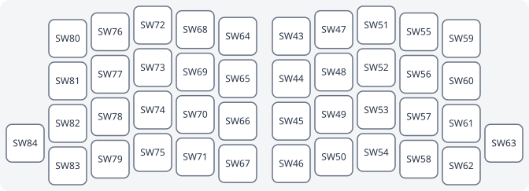
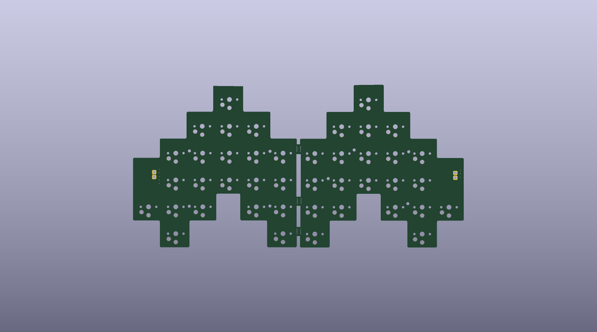
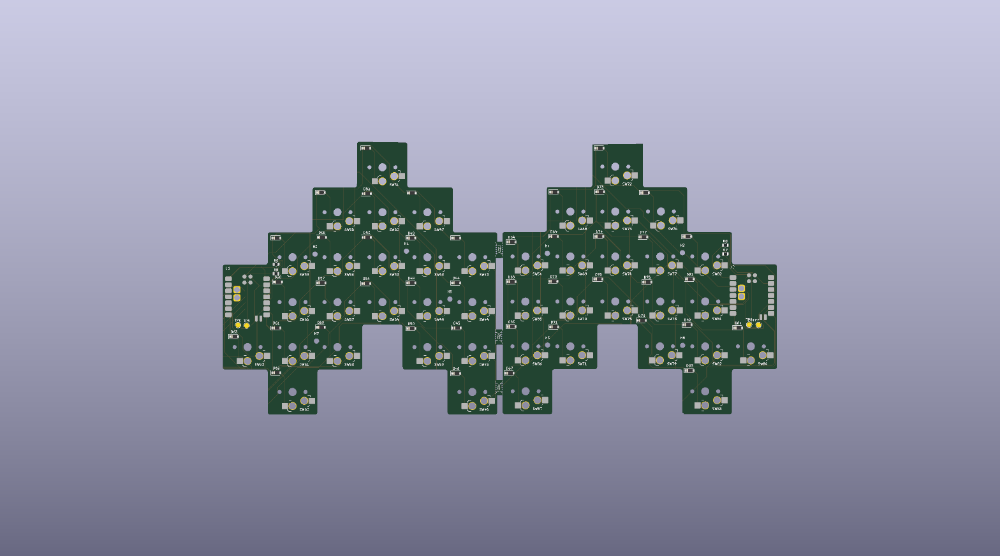
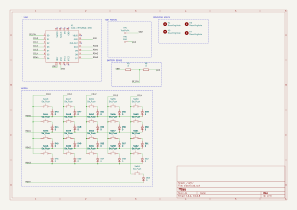

# Split keyboard

A 42-key split keyboard with a KiCad PCB and ZMK firmware for two XIAO
nRF52840 controllers. The left half connects to the host; the right half
connects to the left over Bluetooth.



## Hardware

PCB renders from a local revision (the corresponding PCB edits are not yet committed):




Left-half schematic ([open full size](docs/schematic-left.svg); [right half](docs/schematic-right.svg)):



Open [the KiCad project](src/pcb/pcb.kicad_pro) in KiCad 10. The included
[Gerbers](src/pcb/Gerber-Files/) and [DRC report](src/pcb/DRC.rpt) are older
exports. **Run electrical and design-rule checks, and regenerate the Gerbers
before ordering.** The current board has unresolved DRC findings.

## Firmware

1. Edit [the keymap](src/firmware/config/splitkeyboard.keymap) to choose your
   bindings. The diagram shows the physical switch references.
2. Push your changes and download the left and right UF2 files from GitHub
   Actions. Flash each file to its matching controller.

The firmware uses ZMK v0.3. For a local build, run these commands from the
matching ZMK workspace's `zmk/app` directory:

```sh
west build -p -b seeeduino_xiao_ble -d build/left -- -DSHIELD=splitkeyboard_left -DZMK_CONFIG=/absolute/path/to/splitKeyBoard/src/firmware/config
west build -p -b seeeduino_xiao_ble -d build/right -- -DSHIELD=splitkeyboard_right -DZMK_CONFIG=/absolute/path/to/splitKeyBoard/src/firmware/config
```

The [Keymap Editor](https://nickcoutsos.github.io/keymap-editor/) GitHub
integration expects a root-level `config` directory, so it cannot load this
nested configuration directly. Battery sensing and ZMK Studio are not configured.

Third-party libraries include their own licenses where supplied. No project-wide
license has been specified.
