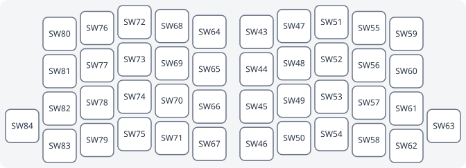

# Firmware

ZMK v0.3 firmware for two XIAO nRF52840 controllers. The left half is central
and connects to the host; the right half connects to the left over Bluetooth.



## Edit and build

1. Edit the bindings in [config/splitkeyboard.keymap](config/splitkeyboard.keymap).
2. Push the changes and download the left and right UF2 artifacts from GitHub
   Actions. Flash each file to its matching controller.

For a local ZMK v0.3 workspace, run these from `zmk/app` with the absolute path
to this repository's `src/firmware/config` directory:

```sh
west build -p -b seeeduino_xiao_ble -d build/left -- -DSHIELD=splitkeyboard_left -DZMK_CONFIG=/absolute/path/to/splitKeyBoard/src/firmware/config
west build -p -b seeeduino_xiao_ble -d build/right -- -DSHIELD=splitkeyboard_right -DZMK_CONFIG=/absolute/path/to/splitKeyBoard/src/firmware/config
```

The [shield](config/boards/shields/splitkeyboard/) defines the matrix; columns
use XIAO D1–D5 and rows use D10–D6. Battery sensing and ZMK Studio are not
configured.

The [Keymap Editor](https://nickcoutsos.github.io/keymap-editor/) GitHub
integration expects a root-level `config` directory and cannot load this nested
configuration directly.
