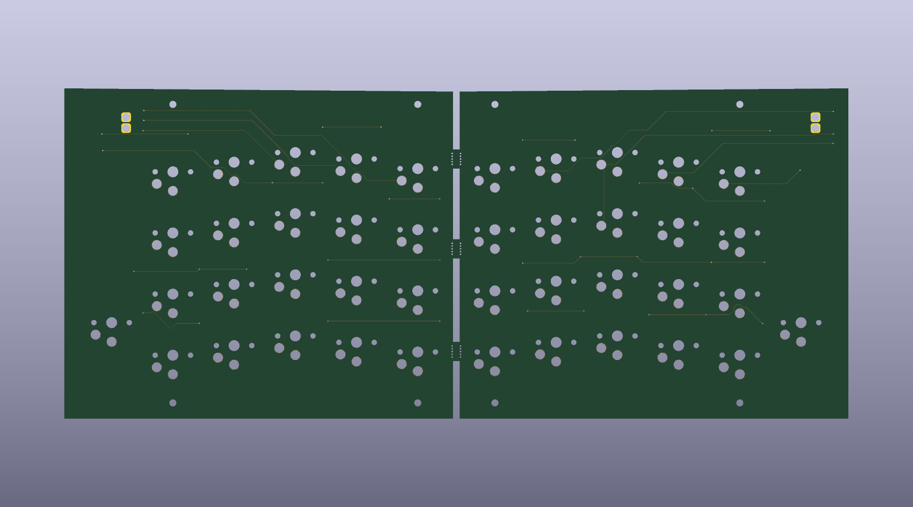
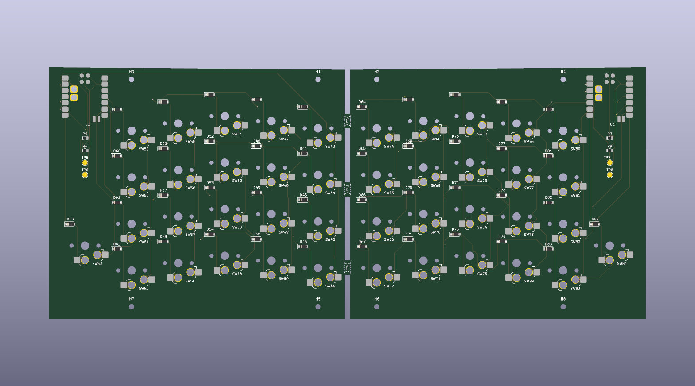
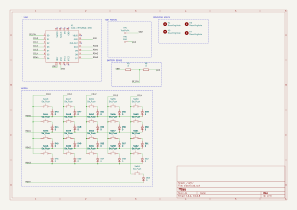

# PCB

Open [pcb.kicad_pro](pcb.kicad_pro) in KiCad 10. The PCB is panelized as two
halves with breakaway tabs.

Switches use 19.05 mm pitch. The five main columns stagger by up to 3 mm between neighbors.

## Schematic

The [root schematic](pcb.kicad_sch) contains left and right sheets. Preview the
[left](../../docs/schematic-left.svg) or [right](../../docs/schematic-right.svg)
half at full size.

## Before ordering

The [Gerbers and drill files](Gerber-Files/) correspond to this layout. The
[KiCad report](DRC.rpt) includes connectivity and schematic parity checks.
Physical keycap fit and typing feel still need a prototype.
